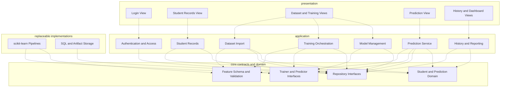

# Student Performance Prediction Quality Scenarios and Module View

## 1. Relevant use cases

| ID | Use case | Primary actor |
|---|---|---|
| UC-1 | Log in and access authorized functions | Administrator, Lecturer |
| UC-2 | Import and validate labeled student data | Administrator |
| UC-3 | Train and evaluate candidate models | Administrator |
| UC-4 | Review and activate a model version | Administrator |
| UC-5 | Predict one student's performance | Lecturer |
| UC-6 | View prediction history and basic statistics | Lecturer, Administrator |

Batch prediction (FR-10) is a later extension to UC-5; the source lists it as optional for the MVP.

## 2. Proposed quality attribute scenarios

These are **design and test scenarios**, not results already achieved. The numeric targets come from the attached report; the triggering events and responses below make them testable.

| ID | Quality attribute | Scenario and expected response | Associated use case |
|---|---|---|---|
| QS-1 | Accuracy | An administrator trains on a valid labeled dataset and evaluates a selected model on held-out student records. The system reports accuracy, precision, recall, F1, and confusion matrix. **Target:** accuracy ≥ 80% and F1 ≥ 0.80; if unmet, the measured result is shown rather than claiming success. | UC-3, UC-4 |
| QS-2 | Performance | Under normal prototype load, a lecturer submits one valid student record. The active fitted pipeline returns a prediction and displays it in **≤ 2 seconds**. If batch prediction is built, **100 records in ≤ 10 seconds** is a separate target. | UC-5 |
| QS-3 | Modifiability | An administrator switches from a Logistic Regression model to an evaluated Random Forest model. The prediction API and UI inputs remain stable, and only the model artifact/registration and model-specific ML code change. | UC-3, UC-4, UC-5 |
| QS-4 | Data integrity | An import row or prediction input has attendance above 100% or a score outside the configured grading scale. Validation identifies the field and rejects the invalid record before training or inference. **Target:** 100% of these invalid test records are excluded. | UC-2, UC-5 |
| QS-5 | Security and privacy | An unauthenticated user or a lecturer without model-management permission requests student records or activates a model. The system denies access; authorized views reveal only permitted student data. **Target:** 100% of protected endpoints enforce authentication and role checks. | UC-1, UC-2, UC-4, UC-5, UC-6 |
| QS-6 | Reliability and reproducibility | A lecturer repeats a prediction with identical validated input and the same model version. The system applies the same fitted preprocessing and returns the same class (and score, where deterministic). **Target:** 100% identical results with unchanged configuration. | UC-5 |
| QS-7 | Usability and explanation | A lecturer unfamiliar with ML enters required academic values, requests a prediction, and reads the result in **≤ 3 main steps**. When a supported explanation feature is enabled, an At Risk result shows at least three influential factors with a clear explanation of what they mean. | UC-5 |
| QS-8 | Availability | During agreed service hours, a process restart or infrastructure failure occurs. Once service is restored, the application can reload the active version and existing prediction history without retraining. **Target from the report:** ≥ 99% availability in a suitable deployment; this depends on operations as well as module design. | All |

The original report numbers its quality attributes QA-01–QA-12. These QS IDs are newly written scenarios grounded in those attributes: QS-1→QA-01; QS-2→QA-02; QS-3→QA-05/06; QS-4→QA-09; QS-5→QA-07/08; QS-6→QA-03; QS-7→QA-04/12; QS-8→QA-11.

### Six-part scenario example for the main architectural driver

| Part | QS-3 Model replacement |
|---|---|
| Source | Administrator/development team |
| Stimulus | Activate a trained Random Forest version in place of Logistic Regression. |
| Environment | A compatible evaluated model artifact exists; users may continue using the prediction form. |
| Artifact | Model Registry, Prediction Service, fitted preprocessing artifact, prediction API. |
| Response | Registry validates the version and switches the active pointer; the next prediction loads the new complete pipeline through the same prediction interface. Prior history retains its original model version. |
| Response measure | No change to the UI contract or student/prediction database schema; no retraining on a prediction request. |

## 3. Module View

**Legend:** Every dashed arrow means a **static source dependency**. An adapter implements an interface defined in `core`; it does not imply a network connection or process boundary.

### Module responsibilities and contracts

| Module | Responsibility | Main contract |
|---|---|---|
| `presentation` | Web forms and readable results for administrator and lecturer; no training logic. | Uses application APIs such as `predictStudent`, `importDataset`, `listHistory`. |
| `application/auth` | Authenticate actors and enforce roles at every protected operation. | `requireRole(actor, action)`; never trust a role supplied by the form. |
| `application/students` | Create, update, delete, and search authorized student records. | `saveStudent`, `findStudent`, `deleteStudent` with access checks. |
| `application/dataset_import` | Receive CSV, validate format/required columns, record accepted/rejected rows, and create a dataset version. | `importLabeledDataset(file): ImportReport`. |
| `application/training` | Coordinate split, fitted preprocessing, candidate models, evaluation, and artifact registration. | `train(datasetVersionId, config): TrainingRun`. |
| `application/model_management` | List metrics and versions; validate and activate one complete compatible model artifact. | `activateModel(versionId): ActiveVersion`. |
| `application/prediction` | Validate input, load active fitted pipeline, infer, and save result with model version. | `predictStudent(actor, input): PredictionResult`. |
| `application/history_reporting` | Read authorized prediction history and aggregate basic dashboard statistics. | `listPredictions(filters)`, `getSummary(period)`. |
| `core/domain` | Represent `Student`, `DatasetVersion`, `TrainingRun`, `ModelVersion`, `Prediction`; define ownership and identity rules. | Domain types and invariants. |
| `core/feature_schema` | Define allowed fields, types, ranges, labels, and schema version; prevent leakage. | `validateInput(input, schemaVersion)`. |
| `core/ml_ports` | Stable model-training, model-loading, and prediction interfaces independent of estimator choice. | `Trainer`, `Predictor`, `ModelArtifact`. |
| `core/repository_ports` | Abstract durable student, dataset, model, and prediction storage. | `StudentRepository`, `DatasetRepository`, `ModelRepository`, `PredictionRepository`. |
| `implementations/sklearn` | Fit scikit-learn preprocessing and estimators; serialize the **fitted pipeline, feature schema, and label mapping together**. | Implements `Trainer` and `Predictor`. |
| `implementations/storage` | Implement repository ports using SQLite for a demo or MySQL/PostgreSQL; store versioned model artifacts. | Implements repository contracts. |

The backend can be a **single Python web application** containing these packages. Separate modules are logical code boundaries, not separate services. Configuration composes concrete ML and storage implementations at startup. The UI and application modules depend on stable contracts, while replaceable implementations depend inward on those contracts.

## 4. Scenario-to-module traceability

| Scenario | Modules carrying the design response | How to verify |
|---|---|---|
| QS-1 Accuracy | Dataset Import, Feature Schema, Training Orchestration, scikit-learn Pipelines, Model Management | Held-out evaluation with recorded metrics and confusion matrix. Fit preprocessing on training data only; avoid feature/label leakage. |
| QS-2 Performance | Prediction Service, Model Registry, fitted ML implementation | Measure end-to-end request time with the active artifact already loaded; test batch separately if implemented. |
| QS-3 Modifiability | Trainer/Predictor Interfaces, Model Management, scikit-learn Pipelines | Replace algorithm and activate a version without editing prediction API, UI contract, or storage schema. |
| QS-4 Data integrity | Feature Schema and Validation, Dataset Import, Prediction Service | Boundary tests for attendance, grade range, missing fields, and CSV schema; invalid rows never reach the model. |
| QS-5 Security/privacy | Authentication and Access, Student Repository, History and Reporting | Permission tests for every protected endpoint; verify pseudonymous demo records and scoped queries. |
| QS-6 Reliability | Model Artifact, Model Management, Prediction Service, Prediction Repository | Repeated inference on identical input/version; history records artifact version and input snapshot. |
| QS-7 Usability/explanation | Prediction View, Prediction Service, ML implementation | Lecturer task test and review of model-appropriate explanations; do not promise three valid factors for an unsupported model. |
| QS-8 Availability | Model Repository, artifact storage, application startup | Restart/recovery and uptime measurements in a chosen deployment. Static module boundaries alone do not establish 99% uptime. |

